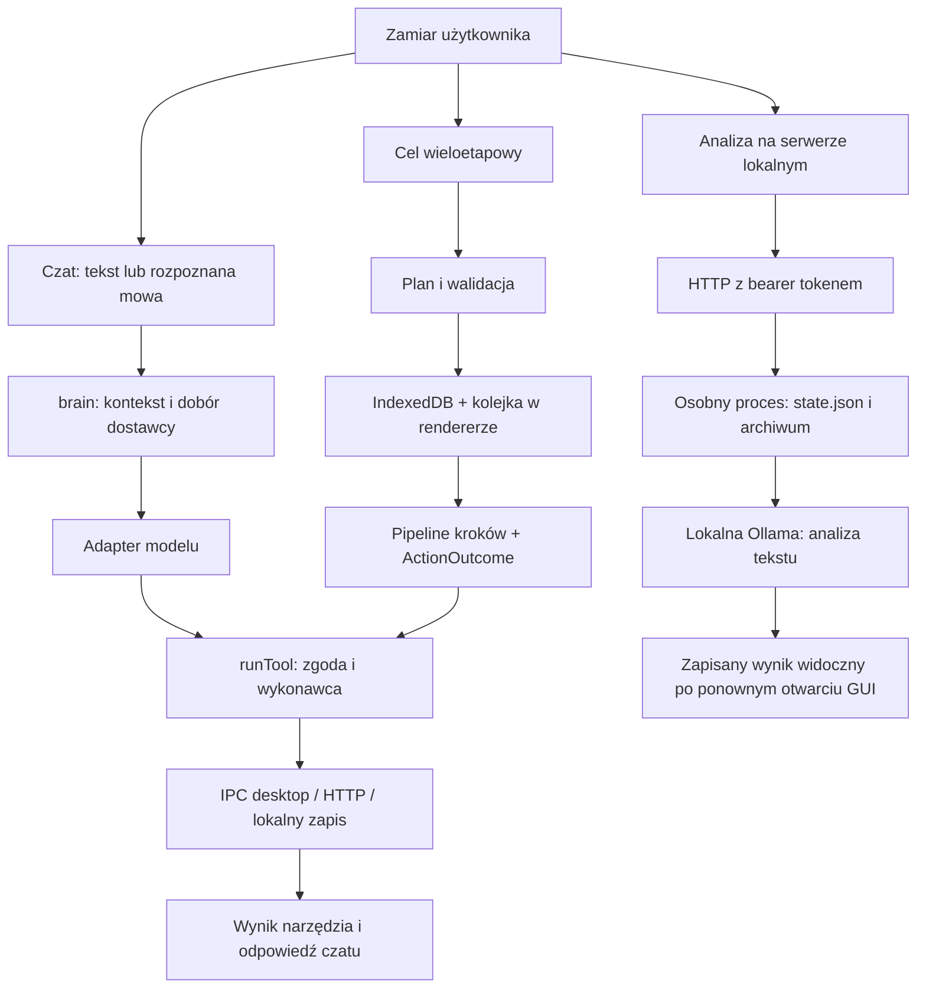

# JARVIS — mapa architektury i pokrycia audytu, 2026-11-05

## Zakres i zasady odczytu

To mapa sprawdzonych ścieżek oraz granic dostępnych dowodów, a nie deklaracja przeglądu każdego pliku. Prześledzono wejścia aplikacji, czat, wykonywanie narzędzi, cele, nowy serwer lokalny, przechowywanie pamięci, integracje desktopowe i konfigurację weryfikacji. Dla pozostałych obszarów odczytano wskazane kontrakty, konfigurację lub reprezentatywne moduły. Liczba plików i nazwa funkcji nie dowodzą jej poprawności.

Punktem odniesienia jest stan roboczy gałęzi o bazie `ca8cda7`, wraz ze zmianami one-click i wynikami z 2026-11-05. Poniższa mapa zachowuje dowody etapu one-click (2929 testów); końcowy zestaw po naprawach audytu to **3013/3013 w 349 plikach, 0 FAIL/SKIP**, z poprawnym lintem i buildem. Granice nowych kontroli opisuje [walidacja końcowa](VALIDATION_2026-11-05.md). Numery linii znalezisk wskazują miejsce w chwili ich zgłoszenia i mogą przesunąć się po naprawie.

- **Fakt statyczny**: ustalony przez odczyt wywołań, implementacji lub konfiguracji.
- **Dowód wykonania**: istniejący wynik testu, smoke testu albo uruchomienia aplikacji; jawnie podano użycie atrap usług.
- **Niezweryfikowane / NOT_RUN**: brak odpowiedniego wykonania w tej sesji. Nie oznacza automatycznie błędu ani braku implementacji.
- **Ocena projektowa / hipoteza**: przewidywany wpływ na użytkownika lub propozycja uproszczenia; nie wynik badań użyteczności.

## Najprostszy sensowny model produktu

JARVIS ma pomagać jednej osobie przejść od polecenia do sprawdzalnego wyniku: odpowiedzieć na pytanie, wykonać dostępną operację albo poprowadzić wieloetapowy cel. Użytkownik powinien widzieć, **co pracuje, gdzie pracuje, co zostało wykonane i jaki jest następny krok**. Nie powinien poznawać portów, tokenów ani nazw adapterów, aby uruchomić już zainstalowany model na swoim Linuksie.

Odpowiedź modelu jest odpowiedzią. Wywołanie narzędzia jest próbą działania. Sukces operacji wymaga wyniku jej wykonawcy lub odczytu potwierdzającego. „Działa po zamknięciu okna” dotyczy tylko zadań przekazanych działającej usłudze. Projekt nie daje dowodu uniwersalnej inteligencji, nieograniczonej autonomii, bezbłędności ani jakości lepszej od wszystkich konkurentów.

Na pierwszym planie powinny pozostać: rozmowa, lista aktualnych prac i wyniki. Konfiguracja szczegółowa, eksperymenty i odrębne produkty mogą pozostać dostępne, ale nie powinny dominować pierwszego uruchomienia. Jest to rekomendacja projektowa, nie potwierdzony pomiarem wzrost użyteczności.

## Mapa obszarów

| Obszar | Główne miejsca | Sprawdzone statycznie | Dostępny dowód wykonania | Pozostaje niezweryfikowane |
| --- | --- | --- | --- | --- |
| Główna aplikacja / nawigacja | `src/main.tsx`, `src/App.tsx`, `src/components/ProNavigation.tsx`, `QuickSettings.tsx`, `runtimeOnboarding.ts` | Uruchomienie React, desktop bootstrap, warunki onboardingu, przejście do panelu serwera, efekty tła, Classic/PRO | Build i lint zestawu one-click; uruchomienie rzeczywistego AppImage; przeglądarkowe smoke i zrzuty wybranych widoków | Każdy ekran i kombinacja ustawień; badania z użytkownikami; pełny audyt dostępności |
| Czat / interpretacja / wynik | `src/App.tsx`, `src/lib/brain.ts`, `generation.ts`, `providers/*` | Wejście tekstu, streaming, router, watchdog, wywołania narzędzi, odrzucanie spóźnionej wiadomości | Testy Vitest routera, gotowości, generacji i kontraktów adapterów | Realna jakość odpowiedzi modelu, wszystkie awarie dostawców, skutki STOP w starym kontrakcie — zgłoszenie F1 |
| Narzędzia / MCP / komputer | `src/lib/tools.ts`, `permissions.ts`, `mcp.ts`, `systemMcp.ts`; `electron/workspace-tools.cjs`, `mcp-stdio.cjs`, `preload.cjs` | Rejestr narzędzi, centralne `runTool`, zgody, domyślne ryzyko nieznanego narzędzia, przejście przez IPC | `tools:verify`: 10 PASS, 2 NOT_RUN; testy granicy IPC i wybranych narzędzi | Wszystkie zewnętrzne serwery MCP; rzeczywista poczta, publikacje, połączenia telefoniczne, płatne lub produkcyjne działania; SQLite i PostgreSQL |
| Cele / kolejka w aplikacji | `goalQueue.ts`, `goalState.ts`, `goalRuntime.ts`, `agentPlanner.ts`, `agentRun.ts`, `agentPipeline.ts`, `GoalStatusPanel.tsx` | Plan JSON, walidacja, zależności kroków, IndexedDB, zapis ATTEMPTED przed efektem, wznowienie i wstrzymanie między krokami | Testy celów i wykonawcy w głównym Vitest, w tym wstrzykiwane wykonawcy narzędzi | Praca narzędziowych celów po zamknięciu renderera — ta ścieżka nie jest usługą systemową; wszystkie rzeczywiste integracje |
| Serwer lokalny / Linux one-click | `server/runtime/server.mjs`, `cli.mjs`; `electron/runtime-launcher.cjs`, `runtime-connection.cjs`; `scripts/install-linux*.sh`, `install-runtime.sh`; `LocalRuntimePanel.tsx` | Autoryzacja, loopback, metadane modelu, faktyczny probe, profil, blokady procesu i profilu, atomowe zapisy, idempotency, archiwum, anulowanie, odzysk | **27 testów runtime**, będących częścią 2929; rzeczywisty AppImage: automatyczny start i konfiguracja, wynik po zamknięciu GUI, ten sam PID/token po ponownym otwarciu — **Ollama symulowana przez HTTP** | Realny model/GPU/RAM użytkownika; wszystkie dystrybucje i konfiguracje systemd; jakość odpowiedzi; daemon nie wykonuje narzędzi systemowych ani kodowania |
| Głos / mikrofon / TTS | `voice.ts`, `voiceSession.ts`, `whisperListener.ts`, `localTts.ts`, głosowe ekrany i obsługa w `App.tsx` | Arbiter właściciela mikrofonu, wybór silnika, rozdział tekstu i mowy, wejście rozpoznanego tekstu do czatu | Wybrane testy jednostkowe formatowania mowy i logiki sesji | Fizyczny mikrofon, rozpoznawanie polszczyzny, przerwania rozmowy, dostępność głosów w systemie użytkownika, wszystkie ścieżki prywatności audio |
| Pamięć / historia / dane | `store.ts`, `db.ts`, `memory.ts`, `MemoryCenter.tsx`, `episodicMemory.ts`, `worldModel.ts`, `memoryService.ts`, `backup.ts` | LocalStorage + IndexedDB, lokalne fakty, epizody, graf encji, opcjonalny Mem0; wejście tych źródeł do kontekstu | Testy magazynu, pamięci i kontraktu Mem0; `memoryService.test.ts`: 10 przypadków w głównym zestawie | Wdrożony Mem0/Qdrant, pełne odtworzenie wszystkich danych między urządzeniami; kompletne usunięcie informacji ze wszystkich źródeł — zgłoszenie F2 |
| Dostawcy / routing / BFF | `providers/registry.ts`, `brain.ts`, `keys.ts`, `http.ts`, `proxy/worker.js` | Dobór dostawcy, lokalna ścieżka, autoryzacja BFF/BYOK, rozdział konfiguracji i gotowości, timeout i failover | Vitest kontraktów HTTP i wyboru trasy; lokalny HTTP fixture Ollamy | Realne klucze, limity, aktualna dostępność wszystkich nazw modeli, koszty i jakość chmury; produkcyjny deployment BFF |
| Bezpieczeństwo / sekrety / uprawnienia | `permissions.ts`, `secretsVault.ts`, `privateMode.ts`, `electron/trusted-renderer.cjs`, `runtime-connection.cjs`, `proxy/worker.js` | Dokładna granica własnego dokumentu IPC, główna ramka/okno, zgody narzędzi, bearer i prywatne pliki runtime; odczyt wybranych kontraktów sekretów | Testy odrzucenia obcego dokumentu, origin/token i odzyskiwanego zewnętrznego endpointu; wcześniejsze reprodukcje znalezionych błędów runtime | Pełny pentest, wszystkie powierzchnie prompt injection, cały model zagrożeń wieloużytkownikowego hosta, niezależny audyt kryptografii, świeże CVE |
| Produkty towarzyszące | `site-os/`, `sales-os/`, `kompas/`, osobne `package.json` i workflow | Osobne aplikacje i cykle życia; Site OS HTTP, Sales OS Next/Prisma, Kompas osobny frontend; nie są jednym backendem JARVIS-a | Site OS izolowany API smoke PASS; Kompas **18/18 E2E PASS**, 0 failed/skipped, na systemowym Chromium | Sales OS lokalny build/API smoke NOT_RUN w tej sesji; połączenie z produkcyjną bazą i pocztą; Site OS osobny wizualny smoke NOT_RUN w inwentaryzacji |
| Mobile / inne systemy | `android/`, `ios/`, `capacitor.config.ts`, natywne pluginy, `.github/workflows/{android,ios,windows}*` | Konfiguracja i wybrane mostki, rozdział web/desktop/mobile; poprawiony identyfikator szablonowego testu Androida | Obecność workflow budowania; to nie jest dowód ich ostatniego sukcesu | Android/iOS/Windows na rzeczywistym sprzęcie, podpisywanie i dystrybucja w tej sesji; Android ma tylko 2 źródłowe testy szablonowe, nie pełny zestaw produktu |
| Testy / CI / artefakty | `vitest.config.ts`, `tests/`, `.github/workflows/`, `scripts/quality-gate.mjs`, osobne zestawy podproduktów | Granice głównego Vitest: `tests/**/*.test.ts`; oddzielne buildy i smoke podproduktów; ścieżki budowania paczek | **2929/2929 PASS, 338 plików, 0 failed/skipped** w zestawie one-click; osobno Kompas i smoke | Nie jest to pokrycie wszystkich ścieżek ani 10000 testów; AppImage E2E środowiska nie jest jeszcze stałą bramką repo — F5 |
| Zależności / aktualność | `package.json`, `package-lock.json`, osobne manifesty podproduktów | Wersje przypięte i publiczne metadane trzech głównych pakietów | Odczyt publicznych `react/latest`, `vite/latest`, `electron/latest` bez wysłania manifestu | **`npm audit` NOT_RUN**: automatyczny review odrzucił wysłanie metadanych zależności do rejestru; brak odpowiedzi na prośbę o zgodę. Nie ustalono obecnej liczby critical/high |
| Eksperymenty / infrastruktura opcjonalna | `src/lib/horizon/`, `src/components/jarvis-ui/`, `src/plugins/`, `server/docker-compose.yml`, `server/lora/`, `server/sd/`, `tools/`, `demo-przempol/` | Sprawdzono reprezentatywne wejścia i konfigurację. `mission_demo` używa jawnego emulatora; `#neural` to osobny opt-in widok | Testy czystych funkcji / emulatorów w głównym zestawie; nie dowód fizycznego urządzenia | Realne ESP32/RPi, trening LoRA, generowanie obrazu, wszystkie pluginy i demonstracyjne projekty |

## Rzeczywiste przepływy i granice procesu

1. **Rozmowa:** `App.handleSend` buduje historię, `askJarvis` zbiera kontekst i wybiera adapter; adapter może zwrócić tekst albo wywołać narzędzie. `runTool` jest wspólną bramką zgody. Błędy, tekst modelu i potwierdzenie efektu nie są równoważne. Stary STOP/timeout nie odcinał całej ścieżki wykonawczej — F1.
2. **Cel:** `planAndEnqueueGoal` prosi model o plan, waliduje go i zapisuje w IndexedDB. `startGoalQueue`, uruchamiane z `App`, wykonuje kroki przez `goalRuntime` i `agentPipeline`. Postęp jest trwały; wykonawca nadal żyje w aplikacji. Zapis ATTEMPTED przed efektem ogranicza niebezpieczne automatyczne wznowienia po przerwaniu.
3. **Analiza w tle:** launcher uruchamia/reużywa usługę, klient odczytuje prywatne połączenie, a backend przyjmuje zadanie z kluczem idempotency. Kolejka zapisuje profil modelu i wynik; działa bez okna GUI. `capabilities` jawnie deklaruje brak coding, voice i processSandbox. Ten zakres nie jest atrapą, ale jest znacznie węższy niż pełny agent narzędziowy.
4. **Pamięć:** czat może korzystać z lokalnych faktów, epizodów, grafu encji, danych projektu oraz opcjonalnego Mem0. Zakończenie rozmowy może aktualizować kilka tych źródeł. Jeden przycisk usuwający fakt nie usuwa automatycznie całego wcześniejszego kontekstu.
5. **Głos:** rozpoznany tekst wchodzi do scenariusza czatu; odczyt odpowiedzi jest dodatkowym etapem TTS. Arbiter mikrofonu ogranicza konkurencję właścicieli sesji. Fizyczna jakość tego przepływu nie była badana w tej sesji.

## Pięć najważniejszych znalezisk architektury i połączeń

Poniższe punkty opisują stan wykryty podczas przeglądu. **Dowody zgłoszenia są historyczne; status wdrożenia jest podany osobno.** Końcowy pełny zestaw po połączeniu zmian: 3013/3013 PASS; szczegóły i NOT_RUN w raporcie walidacji.

### F1 — STOP, timeout i ponowienie nie mają wspólnego kontraktu anulowania

- **Status po naprawie:** wdrożono kontekst anulowania żądania i próby, przekazywany do HTTP, adapterów, narzędzi i zgód; retry po rozpoczęciu narzędzia jest zablokowane. `tests/requestCancellation.test.ts`: 11 przypadków PASS potwierdzonych przez autora zmiany, w tym spóźnione narzędzie po STOP, watchdog/fallback, zgoda po anulowaniu i niezależne wykonanie w tle. Już rozpoczęte narzędzie może dokończyć wewnętrzną pracę; STOP nie cofa efektów. WebLLM może dokończyć obliczenia, lecz spóźniony wynik jest odrzucany.
- **Kategoria / priorytet:** błąd wykonania, P1; potencjalny skutek P0 dla narzędzia nieodwracalnego, ale takiego skutku nie odtworzono.
- **Dowód w chwili zgłoszenia:** `src/App.tsx:786`, `src/lib/generation.ts:14`, `src/lib/brain.ts:864`, `src/lib/providers/openai.ts:153`, `anthropic.ts:129`, `gemini.ts:185`, `src/lib/http.ts:15`. Token generacji zatrzymywał prezentację; `Promise.race` watchdog nie zatrzymywał przegranej próby; adaptery nadal mogły dojść do `runTool`. `fetchTimeout` zastępował sygnał wywołującego własnym sygnałem. Retry otaczał całe wykonanie adaptera, w tym pętlę narzędzi.
- **Skutek:** po „Zatrzymano” może pozostać aktywna praca; po failoverze może istnieć więcej niż jedna próba zdolna wykonać działanie. To wniosek z połączeń w kodzie, nie twierdzenie o wykonanej podwójnej wysyłce.
- **Najmniejsza właściwa zmiana:** kontekst anulowania konkretnego żądania i próby przekazany do HTTP, streamingu, narzędzi oraz oczekiwania na zgodę. Zablokować ponowienie całej próby po rozpoczęciu efektu. Nie używać globalnego STOP do zatrzymywania niezależnych celów.
- **Weryfikacja:** spóźniony tool call po STOP = 0 wykonań; przegrana próba watchdog = 0 późniejszych narzędzi; zgoda po anulowaniu nie uruchamia działania; błąd sieci po efekcie nie odtwarza efektu. Przekazano właścicielowi `brain/providers` do naprawy.

### F2 — „Pełna kontrola nad pamięcią” obejmuje tylko jeden zbiór

- **Status po naprawie:** panel ma nazwę „Zapisane fakty”, jawny zakres usuwania i odnośniki do historii, grafu, ustawień Mem0 oraz danych/kopii. Udostępnia odczyt lokalnych epizodów i ich usuwanie z potwierdzeniem; sukces wymaga odczytu potwierdzającego brak klucza. Dwa nowe testy chronią inne źródła i odmowę magazynu; cały `episodicMemory.test.ts`: 7/7 PASS. Osobna zmiana synchronizacji zachowuje identyfikatory usuniętych faktów, filtrując je przy pobieraniu i przywracaniu kopii (43/43 testów pamięci/synchronizacji potwierdzone przez autora, z czego 9 nowych). To nie usuwa historii, grafu, Mem0 ani kopii na starszych klientach; nowy identyfikator może zawierać tę samą treść. Snapshot POST nie ma CAS, więc równoczesne zapisy urządzeń nadal nie gwarantują globalnej zbieżności.
- **Kategoria / priorytet:** niejasny zakres kontroli danych, P1.
- **Dowód:** `src/components/MemoryCenter.tsx:18` odczytuje `store.data.memory`, a `:36` obiecuje pełną kontrolę. `src/lib/memory.ts:148` usuwa jeden fakt. Inne źródła trafiają do kontekstu w `src/lib/brain.ts:692`, `:714`, `:718`; epizody, graf i Mem0 są aktualizowane przy `:963` i dalej. `clearEpisodes` istnieje, lecz w momencie wyszukiwania nie miał wywołania w UI.
- **Skutek:** usunięcie faktu nie oznacza usunięcia historii, encji ani kopii w opcjonalnej usłudze. Mogą nadal wpływać na odpowiedź.
- **Najmniejsza właściwa zmiana:** nazwa „Zapisane fakty”, jawny opis zakresu kasowania i dostępne kontrole pozostałych źródeł. Pełne „zapomnij wszędzie” wymaga osobnego, jednoznacznego kontraktu; nie kasować podobnie brzmiących danych heurystycznie.
- **Weryfikacja:** sprawdzić osobno odczyt po usunięciu faktu, epizodu, grafu i danych usługi; komunikat nie może deklarować szerszego usunięcia niż wykonane.

### F3 — Trzy wykonawcy i dwa profile modelu wymagają czytelnego rozróżnienia

- **Status po naprawie:** nazwy „Kolejka zadań”, „Analizy w tle”, „Moja lista” i „Plan wieloetapowy” odróżniają wykonanie narzędzi, analizę serwera, ręczną listę i sam tekst planu. Usunięto zdublowane wejście do planera; polecenie „zleć cel” otwiera kolejkę. Testy nawigacji, klawiatury i rzeczywistego dodania/ukończenia zadania przeszły. Nie połączono backendów ani profili modeli.
- **Kategoria / priorytet:** złożoność produktu i połączeń, P1; sam rozdział procesów nie jest błędem.
- **Dowód:** `src/App.tsx:400` uruchamia kolejkę celów renderera; `src/lib/goalQueue.ts:45` i `goalState.ts` przechowują cele w IndexedDB. `server/runtime/server.mjs:242` deklaruje osobne możliwości procesu analiz. `src/lib/runtimeOnboarding.ts:53` zachowuje już skonfigurowany czat; `LocalRuntimePanel.tsx:215` zmienia profil serwera przez PUT, nie pola modelu czatu w `store`.
- **Skutek:** „zadanie” może oznaczać różne rzeczy, z inną trwałością wykonania i innym modelem. Zmiana modelu analiz serwera nie oznacza automatycznej zmiany modelu rozmowy. Ryzyko dezorientacji jest oceną projektową, nie wynikiem badania użytkowników.
- **Warianty:** natychmiastowe połączenie wszystkich wykonawców oznacza dużą migrację i nowe granice uprawnień; pozostawienie niejasnych etykiet utrzymuje problem.
- **Rekomendacja:** zachować wykonawców, ujednolicić prezentację postępu i nazwy: „cel w aplikacji”, „analiza na serwerze”, „model czatu”. Ewentualne zastosowanie modelu w obu ścieżkach musi być świadomą akcją, bez nadpisywania konfiguracji chmury.
- **Weryfikacja:** zamknąć GUI z jednym zadaniem każdego typu i pokazać prawdziwy stan po otwarciu; zmiana profilu serwera nie może być prezentowana jako globalna, jeśli czat go nie zmienił.

### F4 — Duże moduły skupiają wiele niezależnych obowiązków

- **Kategoria / priorytet:** dług techniczny, P2; brak dowodu, że sam rozmiar powoduje konkretny błąd.
- **Dowód pomiaru:** w momencie mapowania `App.tsx` miał 1843 linie, `brain.ts` 1026, `tools.ts` 1927, `Settings.tsx` 3468. `App` zawiera orkiestrację rozmowy, audio, nawigację, start kolejki oraz wiele pętli proaktywnych. `brain` łączy routing, pamięć, retry, narzędzia i rozliczanie odpowiedzi. Nazwy i importy pokazują rzeczywiste połączenia, nie tylko duże pliki.
- **Skutek / hipoteza:** trudniej ustalić, która warstwa odpowiada za anulowanie, wynik i stan operacji; rośnie koszt review. Nie zmierzono wydajności ani kosztu utrzymania.
- **Najmniejsza właściwa zmiana:** najpierw wydzielić wspólny kontekst wykonania i jego testy przy naprawie F1. Dopiero przy następnych zmianach przenosić spójne efekty startowe i prezentację ustawień do osobnych modułów. Nie wykonywać masowego przepisywania katalogów tylko dla redukcji liczby linii.
- **Weryfikacja:** zachować istniejące kontrakty i testy; wykazać usunięcie powielonej odpowiedzialności, nie wyłącznie przeniesienie kodu.

### F5 — Najważniejszy dowód desktopowy wymaga powtarzalnego skryptu

- **Status wdrożenia:** dodano wersjonowany `scripts/smoke-linux-runtime.mjs`, `npm run test:linux-runtime` i [instrukcję](LINUX_RUNTIME_SMOKE.md). Skrypt używa osobistego AppImage i izolowanych danych. Nie włączono go do CI budującego licencjonowany artefakt; wymaga to odrębnej paczki testowej. Końcowy wynik wykonania jest w [raporcie walidacji](VALIDATION_2026-11-05.md).
- **Kategoria / priorytet:** luka w ochronie przed regresją, P1.
- **Dowód:** `.github/workflows/ubuntu.yml:32` buduje i pakuje, następnie publikuje artefakt; `.github/workflows/test.yml:32` uruchamia Vitest i build. Zestaw AppImage przeżycia GUI znajduje się w środowisku pod `/workspace/.jarvis-cloud/one-click-appimage.mjs`. Nie jest to wersjonowany skrypt testowy projektu.
- **Skutek:** bieżący sukces nie gwarantuje, że następny pakiet zachowa uruchamianie usługi, prywatne discovery i pracę po zamknięciu okna.
- **Najmniejsza właściwa zmiana:** przenieść stabilny smoke do repo jako osobny, jawny test paczki z izolowanym katalogiem danych i atrapą Ollamy. Uruchamiać po zbudowaniu AppImage w odpowiednim środowisku GUI/Xvfb; zachować wyraźne oznaczenie atrapy modelu.
- **Weryfikacja:** test obejmuje start z pustym profilem, wykrycie modelu, zapis wyniku po zamknięciu GUI, ponowne użycie PID/tokenu i sprzątanie własnych procesów. Nie może łączyć się z prywatnymi danymi ani prawdziwą pocztą użytkownika.

## Rejestr dowodów wykonania

Artefakty poniżej są lokalne dla tej sesji, poza repozytorium; nie są publicznymi linkami do produktu.

| Dowód | Wynik i ograniczenie | Artefakt |
| --- | --- | --- |
| Końcowy Vitest po audycie | **3013/3013 PASS, 349 plików, 0 FAIL/SKIP**. Lint, TypeScript i produkcyjny build również PASS. | `/workspace/.jarvis-cloud/audit-final-vitest.json`, `audit-final-lint.log`, `audit-final-build.log` |
| Wersjonowany AppImage smoke po audycie | **PASS**: start, konfiguracja, wynik po zamknięciu GUI, ponowne użycie procesu/tokena i cleanup. Model symulowany. CI NOT_RUN. | `scripts/smoke-linux-runtime.mjs`; `/workspace/.jarvis-cloud/audit-final-appimage.log` |
| Pełny główny Vitest one-click | 2929 PASS, 338 plików, 0 FAIL, 0 skipped. 1134 suites opisuje strukturę zestawu, w tym grupy `describe`, nie dodatkowe przypadki. | `/workspace/.jarvis-cloud/one-click-final-vitest.json` |
| Lokalny backend | 27 przypadków `localRuntime.test.ts` w powyższym zestawie, nie dodawać ich ponownie do 2929. Obejmuje m.in. HTTP, restart/SIGKILL, idempotency, archiwizację, wybór modelu i wyścigi profilu; usługa modelu symulowana. | Ten sam JSON; `/workspace/.jarvis-cloud/local-runtime-autostart-tests.log` |
| Linux AppImage one-click | PASS potwierdzony wykonaniem przez zespół: start, konfiguracja czatu, probe, wynik po zamknięciu okna, reużycie procesu i tokenu. **Rzeczywisty AppImage, symulowana Ollama**, bez oceny jakości modelu. | `/workspace/.jarvis-cloud/one-click-appimage.mjs`, `one-click-appimage.png` |
| Kompas | 18/18 E2E PASS, 0 FAIL/SKIP/flaky; osobny produkt i osobny zestaw. | `/workspace/.jarvis-cloud/test-inventory-kompas.json` |
| Site OS | Izolowany smoke API PASS, bez serwera użytkownika. | `/workspace/.jarvis-cloud/test-inventory-site-os.log` |
| Narzędzia workspace | 10 PASS; SQLite i PostgreSQL NOT_RUN z powodu brakujących narzędzi/połączenia. | `/workspace/.jarvis-cloud/test-inventory-workspace-tools.log` |
| Inwentaryzacja początkowa | 2835 testów / 331 plików; później zastąpiona zestawem 2929 / 338. **Nie sumować uruchomień.** | `/workspace/.jarvis-cloud/test-inventory-summary.json` |
| Lint / build / paczka one-click | Zakończone w tym etapie; nie dowodzą poprawności realnego modelu ani wszystkich platform. | `/workspace/.jarvis-cloud/one-click-final-lint.log`, `one-click-final-build.log`, `one-click-package.log` |
| Panel zapisanych faktów po F2 | 7/7 testów epizodów, ESLint PASS; izolowany komponent w Chromium: 320/1280 px, brak poziomego przepełnienia, dodanie faktu, anulowanie potwierdzenia, usunięcie samych epizodów, widoczna odmowa magazynu i intencja przejścia do historii. 0 błędów strony. To nie jest pełny E2E aplikacji ani usunięcie danych Mem0. | `/workspace/.jarvis-cloud/memory-center-tests.log`, `memory-center-browser.log`, `memory-center-320.png`, `memory-center-320-storage-error.png`, `memory-center-1280.png` |

Nie potwierdzono deklaracji „10000 testów”. Znalezione historyczne liczby w dokumentacji dotyczą różnych stanów projektu; wystąpienia `10000` dotyczą także kwot, timeoutów i limitów usług. Nie należy sumować powtarzanych uruchomień ani przedstawiać liczby testów jako procentowego pokrycia funkcji.

## Dodatkowe błędy odtworzone i naprawione

Poniżej wynik pracy nad głównymi przepływami, poza pięcioma znaleziskami architektonicznymi. Oznaczenie P0 opisuje wagę naruszenia prywatności lub utraty stanu; nie dowodzi incydentu na komputerze użytkownika.

| Priorytet i problem | Przyczyna / zmiana | Sprawdzenie |
| --- | --- | --- |
| P0: prywatny czat zasilał automatyczną pamięć | `conversationPrivacy.ts`, `brain.ts`, `council.ts`, `tools.ts`, `App.tsx`: polityka konkretnej rozmowy wyłącza automatyczne fakty, epizody, graf i Mem0, ogranicza narzędzia pamięci i redaguje audyt. Nie zmienia globalnych ustawień innych zadań. | Regresje prywatnej/normalnej rozmowy i równoległego żądania. Prywatność nie oznacza braku przesłania treści do wybranego modelu; jawnie zlecone działania nadal mogą zapisywać dane. |
| P0: spóźniony worker nadpisywał pauzę lub anulowanie celu | `goalState.ts`, `goalRuntime.ts`, `GoalStatusPanel.tsx`, `agentRun.ts`: odczyt–zmiana–zapis pod wspólną blokadą, dodatkowe sprawdzenie zatrzymania przed narzędziem. | Regresje prawdziwego wykonawcy z kontrolowanymi punktami oczekiwania: pauza, anulowanie, checkpoint i stary wpis kolejki. |
| P1: usunięta aktywna rozmowa wracała przez autosave | `ChatHistory.tsx` zgłasza faktycznie usunięte ID dopiero po poprawnym zapisie; `App.tsx` przerywa starą generację i przechodzi do nowej rozmowy. Edycja korzysta ze świeżych danych. | 4 testy DOM/magazynu; rzeczywisty App w Chromium: usunięcie aktywnej rozmowy, kolejne polecenie, brak starego ID i treści. |
| P1: usunięty fakt wracał ze starej synchronizacji lub kopii | `memory.ts`, `store.ts`, `sync.ts`, `backup.ts`: identyfikatory usunięć łączone i stosowane także przy hydratacji IndexedDB. | Stary snapshot, dwustronne metadane usunięć, stare kopie, nowy fakt z nowym ID. Ograniczenie równoległego snapshot POST pozostaje opisane w F2. |
| P1: mikrofon uruchamiał się po Stop lub stale ponawiał błąd | `voice.ts`, `whisperListener.ts`, `voiceLoop.ts`, `App.tsx`: właściciel konkretnego startu, zamykanie spóźnionych strumieni, stan oczekiwania, zatrzymanie pętli po błędzie. | Regresje start–stop–start, opóźnionej zgody i błędu AudioContext; Chromium z symulowanym mikrofonem. Stan „myślę” nie znika po zakończeniu rozpoznawania. |
| P1: brak wykonania był traktowany jak sukces | `tools.ts`: jawny błąd mutatora zwraca `{ok:false,error}`. Brak dopasowanego zadania w `complete_task` kończy się `FAILED`. | 16 regresji nieudanych i poprawnych mutacji oraz wykonawcy. `CONFIRMED` analizy nadal nie dowodzi prawdziwości wygenerowanego tekstu. |
| P1: przycisk testu Mem0 pokazywał sukces po błędzie | `memoryService.ts`, `Settings.tsx`: osobny test połączenia odróżnia poprawną pustą listę od błędu HTTP, sieci i formatu. | Pusty wynik, HTTP 503, zły JSON, awaria sieci i zakaz połączenia w trybie urządzenia. Test dotyczy odczytu konkretnego endpointu. |
| P1: nowe zadanie nie było od razu widoczne | `TaskHub.tsx`: usunięto memoizację po niezmieniającej się referencji mutowanej tablicy. | Test DOM i Chromium: dodanie, licznik, odhaczenie i przeniesienie do wykonanych. |
| P1: jednoczesne zgody zasłaniały się i blokowały zadanie | `permissions.ts`, `App.tsx`: wspólna kolejka FIFO i identyfikator każdego dialogu. Anulowanie usuwa własną zgodę, spóźniona odpowiedź nie zamyka kolejnej, odpięcie UI odmawia oczekującym. | 8 nowych regresji, w tym rzeczywisty komponent PermissionDialog, dwie zgody na to samo narzędzie i reset checkboxa. Scoped 46/46 PASS. |
| P1: wadliwy wpis pamięci powodował wyjątek przy odczycie ID | `store.ts`: odrzucanie niepoprawnych elementów tablicy przed filtrowaniem usunięć. | Regresje normalizacji przy starcie i importu kopii zawierającej `null` oraz typy proste; poprawne fakty pozostają. |
| P2: nieczytelność i mylące wskaźniki | Nawigacja odróżnia kolejkę, analizy, ręczną listę i plan tekstowy. Usunięto stałą ocenę „inteligencji”; liczniki opisują konfigurację. History/TaskHub używają wspólnego modala. Komunikaty Ollamy uwzględniają system i lokalny adres. | Klawiatura, fokus, Classic/PRO i wybrane widoki przy 320–1440 px. To weryfikacja techniczna i ocena projektowa, bez badań użyteczności. |

Wybrano naprawę kontraktów wykonania i przechowywania, zamiast migracji całego stanu do nowego backendu w jednym kroku. Zachowano działające integracje i formaty danych, dodając zgodne wstecz metadane usunięć. Uproszczenie nawigacji pozostawia dostęp do dotychczasowego planera, lecz nie przedstawia jego tekstu jako wykonanych działań.

## Co pozostaje propozycją

- Jeden wykonawca narzędzi i wspólny stan urządzeń: wymaga migracji, odtwarzania po awarii i jasnego kontraktu efektów zewnętrznych. Obecny runtime nadal wykonuje tylko tekstowe analizy.
- Silna izolacja narzędzi i zgody egzekwowane przez proces główny: własny zaufany renderer ma dostęp do bridge IPC; przejęcie jego JavaScript nie jest ograniczone samą bramką UI. Nie odtworzono w tej sesji takiego przejęcia przez prompt.
- Niezależny weryfikator efektów: role planner/coder/tester/reviewer są etapami, a istniejący `resultVerifier` ocenia statusy. Nie testuje semantycznie wszystkich kryteriów sukcesu.
- Jednolite usunięcie informacji ze wszystkich źródeł, przeglądanie/usuwanie archiwum analiz i rozwiązywanie konfliktów synchronizacji po stronie serwera. Archiwum przechowuje pełne polecenia i wyniki; nie ma automatycznego okresu retencji.
- Trwały klucz ponowienia w kliencie analiz: serwer ma idempotencję, ale po utracie odpowiedzi i zamknięciu panelu klient może utracić swój niezakończony klucz. Przed ręcznym ponowieniem trzeba sprawdzić kolejkę.
- Pomiar jakości polskiego głosu, realnej inferencji, działania offline i porównania z konkurencją na wspólnym zbiorze zadań. Bez takich wyników nie ma podstaw do obietnicy bezbłędności.

## Aktualność zależności i granice dalszych wniosków

Publiczny odczyt metadanych dał: React `18.3.1` → latest `19.3.1`; Vite `5.4.21` → `8.3.5`; Electron `33.4.11` → `45.2.3`. Wszystkie przejścia przekraczają główną wersję, więc wymagają sprawdzenia migracji. Vite latest wymaga Node `^20.19.0 || >=22.12.0`, Electron latest `>=22.12.0`. Electron figuruje w devDependencies, ale jest środowiskiem wykonawczym dostarczanej aplikacji desktopowej.

Źródło odczytu: `/workspace/.jarvis-cloud/dependency-latest-public.json`. Nie wykonano `npm audit fix` ani automatycznej aktualizacji zależności. Świeży `npm audit` pozostaje zablokowany do odpowiedzi na przekazaną użytkownikowi prośbę: automatyczny review odrzucił przesłanie metadanych zależności do rejestru npm. **Nie ma podstaw do podania bieżącej liczby critical/high ani do stwierdzenia, że wszystkie zależności są bezpieczne.**

Nie badano skuteczności JARVIS-a względem konkurencji na wspólnym benchmarku, nie przeprowadzono badania użyteczności i nie zmierzono wydajności prawdziwego modelu użytkownika. Tych ograniczeń nie zastępuje samoocena „10/10” lub „13/10”.
